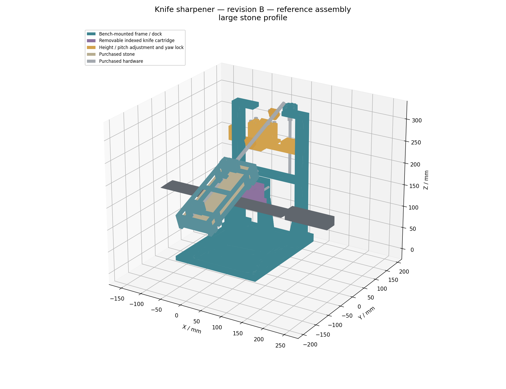
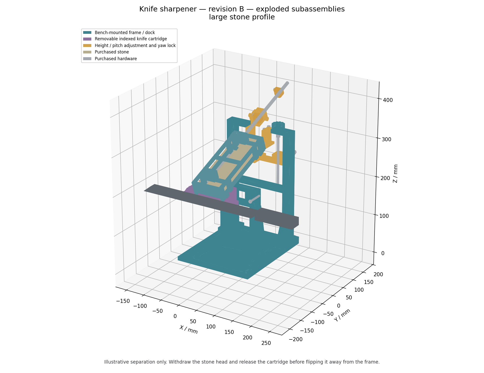

# CAD_TEST2 — compact guided knife sharpener, revision B

A mostly 3D-printed, **bench-mounted prototype** for guided sharpening. Revision B replaces the tall rotating axle assembly with a removable knife cartridge that is indexed on two metal dowels and retained by two draw screws. The cartridge is withdrawn and inverted **away from the fixture**; the knife is never flipped above the base.

The mounting footprint is **200 × 240 mm**, the printed frame reaches **300 mm**, and the fine-height screw reaches **315 mm**. Knife and guide-rod travel extend outside that footprint. The reference blade midplane is 150 mm above the base. Revision B supersedes revision A; its parts and operating procedure are different.

**This is CAD for a prototype. Physical fit, wet-use retention, loaded accuracy and structural strength have not been demonstrated.** Read the completed results and limitations in [cad/validation.json](cad/validation.json), then perform the [prototype acceptance checks](docs/revision-B.md) before sharpening a real knife.





## Choose the stone profile

| Profile | Stone width × length × thickness | Stone-face-to-rod offset | Intended use |
|---|---|---:|---|
| `large` — default exports | 60 × 180 × 30 mm | 44 mm | Reuses the original double-sided stone |
| `slim` — optional exports | 25 × 150 × 6 mm | 20 mm | A lighter, narrower abrasive head |

The two profiles use different cassette geometry and guide-height reference scales. Use one complete profile; do not mix its cassette, scale or validation report with the other profile. Both use a **smooth, ground Ø8 × 400 mm shaft**. Threaded rod is unsuitable for this sliding shaft.

The reference knife has a 300 mm cutting length and a 100 mm handle envelope. Nominal blade thickness at the clamp is 1–6 mm, using the universal upper jaw and the selected lower centering shim. Capacity depends on blade shape and protrusion as well as length. The 15–25° scale is a center-contact reference. **Working yaw is positively locked at 0°**; sharpen long or curved edges in short, repositioned sections. This is not a continuous constant-angle traverse.

## Files and downloads

- [Revision B, original-stone bundle](knife_sharpener_rev_B.zip)
- [Revision B, slim-stone bundle](knife_sharpener_rev_B_slim.zip)
- [sharpener_assembly.step](sharpener_assembly.step): assembled default-profile geometry, including individual hardware envelopes.
- [parts/](parts/): separate STEP models at assembly coordinates. `REF_` parts are purchased/reference items; do not print them.
- [print/](print/): preoriented, origin-normalized STL and STEP files for printed parts, including optional centering shims for 1–6 mm blades. Print one universal upper jaw and only the selected shim. Orientation is a starting point; inspect supports, bridging and layer strength in the slicer.
- [cad/purchase_bom.csv](cad/purchase_bom.csv): authoritative generated quantities. [cad/hardware_manifest.json](cad/hardware_manifest.json) contains the same purchase counts.
- [cad/cost_estimate.csv](cad/cost_estimate.csv): Israeli-shekel planning allowances, not live supplier quotations.
- [cad/design.json](cad/design.json): profile dimensions, mechanical interfaces and operating metadata.
- [cad/validation.json](cad/validation.json): results for the actual exported files, including provenance hashes.
- [cad/config.py](cad/config.py), [cad/generate.py](cad/generate.py): parameterized source.
- [docs/revision-B.md](docs/revision-B.md): review changes, remaining limitations and physical acceptance procedure.

A bundle contains one profile and its report. The default checkout represents `large`; the slim bundle is generated and checked separately.

## What changed

- Removed the loose hex rotor joint, M10 axle and questionable disc-retention stack. A broad, ribbed cartridge root replaces the narrow jaw-to-journal neck.
- Added two Ø6 mm metal locating dowels, a round bore and a relieved bore, plus two metal-thread draw screws. The pins locate; the broad mating face and draw screws retain and preload the cartridge.
- Replaced the ballast box, lid, tall pedestals and split tower with a ribbed bench base and braced open frame. **Two bench clamps or a bolted board mounting are required.**
- Added fine M6 screw height adjustment, independent working-position clamps, pitch articulation and a replaceable guide sleeve. A positive M4 yaw-lock bolt keeps the working plane at 0° yaw.
- Shortened the guide shaft from 500 to 400 mm and replaced tapped-plastic stop collars with captive-nut split collars.
- Added a ribbed stone cassette with fixed corner supports and a two-screw removable end gate. Grit changes no longer require removing four loose keepers.
- Added fit coupons, a 28 mm protrusion gauge, oriented print files, a complete BOM, full-assembly hardware checks and reproducible packaging.

The freestanding ballast-box alternative is not retained: removing it is the chosen way to reduce size. A long transverse guide was also not added; it would increase the envelope. For consistent bevel work, keep the positive yaw lock installed and reposition the knife in short sections using the protrusion datum, recalibrating as needed. Removing that lock does not create a supported wider-yaw operating mode.

## Before printing

Use PETG for the cassette, jaws, shims and sleeve. PETG or ASA is a starting choice for the frame and base. PLA may be used for dimensional fit prototypes. Select material and print direction through testing; a filament choice alone does not establish strength or creep resistance.

Print `COUPON_bearing_and_dowel_fits` first. Check the actual steel rod, dowels and sleeve fits. Nominal guide-sleeve dimensions are **8.1 mm ID, 12 mm OD and 40 mm length**; its housing bore is 12.05 mm. The coupon includes alternative shaft bores. Tune or carefully finish a copy for your printer, keeping sliding motion free without obvious rocking. Never force the shaft through or use abrasive slurry as lubricant. The sleeve is replaceable and retained by an M4 × 25 split-clamp screw with a captive metal nut. Tighten just enough to retain it without closing the sliding bore; loosen that screw before replacement. A purchased polymer sleeve with matching measured dimensions can be evaluated instead.

The 200 × 240 mm base and approximately 200 × 290 mm frame, including its feet, need the larger **325 × 320 × 325 mm printer**. Some other parts approach a 180 mm bed; inspect the actual preoriented bounds and allow room for brim/supports. No model should be scaled to fit a printer. The supplied orientation checks concern geometry and bed fit, not a validated support strategy or layer strength.

Start with 0.2 mm layers, 5–6 perimeters and 6 top/bottom layers. Use 40–50% infill for structural parts and locally higher fill around mounting holes, jaw roots, clamp bosses and gimbal features. Fit-check the small interfaces before printing the large structure. These are prototype starting settings, not certified print specifications. Inspect the slicer's actual filament and support estimates.

Print the fixed stone-retaining corner ledges locally solid: **3 mm thick for the large stone and 2 mm for the slim stone**. The slim ledges sit nearer the stone ends to clear both jaw orientations through the full stroke. Inspect layer continuity and test retention with the actual wet stone over padding before bringing it near a blade.

The assembled export uses a 3 mm blade with `05_upper_knife_jaw` and `06_blade_shim_3mm`. The **same universal upper jaw** fits the supported 1–6 mm thicknesses; only its clamped height changes. For each other integer thickness from 1 to 6 mm, the exports include `OPTION_blade_shim_for_Nmm`. **Print one upper jaw and one centering shim for the actual blade thickness, not all the shim options.** Optional shims are excluded from the installed assembly and installed-material totals. No configuration edit is needed to select a supplied shim. For blade thickness `t` in millimetres, revision B uses:

```text
shim height = 3.5 − t/2 mm        for 1 ≤ t ≤ 6
```

The 122 mm-wide shim supports the universal jaw, including its outboard clamp ears. The lower shelf is at Z=146.5 mm. Account for protective tape in the actual blade stack. The 0.5 mm shim for a 6 mm blade needs careful first-layer control. For an intermediate thickness, generate and validate the matching shim from the source rather than treating the nearest supplied shim as exact. A modified jaw needs its own validation.

## Purchased parts and tools

Use [the generated purchase BOM](cad/purchase_bom.csv), not revision A's shopping list. It includes each modeled bolt, nut, washer, dowel and shaft; cushions and mounting supplies must also be procured. The required bench clamps are ordinary purchased clamps, not printed load-bearing substitutes. If using a bolted board instead, select the board fasteners to suit that board and bench.

Important items include the Ø8 × 400 mm ground shaft, two Ø6 × 30 mm locating dowels, metal M4/M5/M6/M8 hardware, two bench clamps, firm 2 mm stone backing, non-marring blade protection and soft screw-tip pads. The fine-height screw is M6 threaded stock cut to **160 mm**; deburr its ends and verify nut travel. No custom-machined metal components are required. There are no tapped-plastic working threads in revision B.

You need calipers, suitable hex keys/spanners, deburring tools and an angle-measurement method such as a digital angle gauge. Fit adjustment may require controlled drilling/reaming. Buy corrosion-resistant hardware where practical; the sliding shaft must remain smooth and straight.

The current default assembly contains approximately **1.3 L of printed solid CAD volume**, around **67% less than revision A's 3.93 L**. Fully solid PETG at 1.27 g/cm³ would weigh about 1.6 kg; infill, shells and supports change the actual print consumption. Plan to buy **two 1 kg spools** initially, approximately **₪140–240** at an assumed ₪70–120/kg, then refine this using your sliced files. This is a purchasing allowance, not a measured print result.

The cost CSV uses approximate Israeli retail allowances in ILS. Prices, pack sizes and shipping vary; obtain supplier quotations before ordering. The bill of materials, analytical CAD volume and any print-material estimate serve different purposes and must not be treated as measured filament consumption.

The default-profile engineering estimate is approximately **1.2–1.7 kg PETG including a 15% support/waste allowance**. Budget approximately **₪300–655 with the stone already owned**, or **₪360–835 including a basic original-size stone**, two clamps and two whole filament spools. Shipping, tools, labor and failed full reprints are excluded. The slim profile is approximately **₪330–755 including its stone**. Regenerate [the itemized budget](cad/cost_estimate.csv) and [its assumptions](cad/cost_summary.json) with `python cad/estimate.py`; actual sliced consumption and supplier quotes take precedence.

## Assembly

### 1. Mount the base and frame

1. Clean support material and verify all mounting holes and nut access pockets. Fit the eight M5 × 20 base-to-dock/frame bolts upward through the underside counterbores. Their heads must remain flush enough for the base to sit flat.
2. Install `02_open_portal_frame` and `03_fixed_cartridge_dock` on their base pads, using the M5 nuts in the accessible pockets. Align and tighten evenly without crushing the printed ribs.
3. Clamp the base to a rigid bench using two commercial clamps on the reinforced bosses centered at X=±90, Y=−25. Protect the bench and distribute clamp pressure. Alternatively, bolt the two front mounting holes to a rigid board securely attached to the bench. Do not use this revision freestanding or replace mounting with a light handhold.
4. Confirm the frame does not rock, the mounting hardware is accessible, and the full knife/rod movement has clear space around the bench.

### 2. Fit the height adjustment and guide

1. Insert the captive M6 travelling nut into the side pocket of `05_height_carriage`. Fit the carriage in front of the two frame slots with the two M6 × 45 bolts, washers and nuts. Leave the clamps just free enough for adjustment.
2. Feed the M6 × 160 fine-height screw through the right-hand top arm and travelling nut at X=50, Y=130. Install the upper/lower washers and jam-nut pairs according to the exploded view. Use spanners to lock each nut pair to the screw **before sliding the keyed knob over the upper pair**, because its socket otherwise obstructs access. Do not pinch the frame between thrust faces; the screw must rotate freely with little axial movement. Verify the retaining stack cannot walk loose during repeated adjustment.
3. Attach `06_yaw_plate` to the narrow shelf with its **M8 × 25** locating pivot bolt, two thrust washers and retaining nut. The short bolt keeps the tip below the pitch housing. Align the plate at 0° yaw, then fit the separate **M4 × 25 positive yaw-lock bolt**, washers and nut through the rear shelf/plate boss at Y=118. Both bolts remain installed during sharpening; the plate must not yaw under working force.
4. Insert the calibrated sleeve into `08_pitch_housing` and fit its captive-nut M4 × 25 split-clamp screw. Retain the sleeve without squeezing the bore enough to bind the shaft. Place the housing trunnions between the two `07_pitch_cheek` parts and fasten the cheeks to the yaw plate with their bolts, washers and nuts. Do not spring the cheeks apart to force in an assembled housing.
5. Verify free pitch and rod sliding, with yaw locked at 0°. The frame's central opening must remain clear of the rising rod. Tighten the two height clamps after setting the angle; the adjustment screw is not the working-position brake.

### 3. Assemble the knife cartridge

1. Fit the two Ø6 × 30 locating dowels into the stationary dock, with the specified projection toward the knife. The cartridge has one round locating bore and one horizontally relieved bore to avoid overconstraint. Fit them using the coupon and actual pins, then insert their captive nuts through the rear access slots and fit the two **M4 × 16 dowel-retaining grub screws**. Tighten lightly to retain the pins without damaging the dock, and verify neither pin pulls out when the cartridge is removed. Do not hammer a loaded knife cartridge onto the dock.
2. Use the universal upper jaw with the selected centering shim. Insert the upper jaw's captive M5 jack-screw nuts. Install the two **M5 × 25 jack screws** and locknuts, then the two **M6 × 30 jaw-clamp bolts**, washers and lower nuts. The rear clamping ears are outside the cassette's path and provide flat washer seats; do not substitute the longer revision A bolts.
3. Place the selected blade-centering shim on the lower shelf. Clamp a **blunt test blade first**, with thin protection as needed. Set the cutting-edge datum 28 mm ahead of the jaw nose, using the separate gauge on a protected/blunt blade. The reference edge is Y=−70 and the nose is Y=−42.
4. Adjust both rear jack screws so tightening the M6 clamps loads the jaw noses evenly. Tighten alternately by hand and verify grip. Do not use high torque to compensate for a poor fit or a badly centered blade.
5. Seat the cartridge fully against the dock's broad planar face. Install and evenly tighten both M5 draw screws with their washers into the captive dock nuts. Check full face seating, no perceptible free rocking and positive retention. The locating pins alone do not retain the cartridge.

### 4. Load the stone cassette

1. Insert the cassette's captive clamp, side-adjuster and gate nuts before access is obstructed. Fit the soft side/end pads and firm 2 mm backing strips at the three roof ribs.
2. Back off all four padded side adjusters, then remove the two end-gate screws and gate. Slide the stone axially into the cassette without dragging or losing the loose pads. Its fixed corner ledges carry it; the central abrasive working area must remain unobstructed. Do not force a stone that differs from the selected profile's actual dimensions.
3. Refit the gate and both screws. Bring the padded side adjusters just into contact without loading the brittle stone excessively. The screws locate the stone; the corner ledges and end gate provide positive retention.
4. Slide the smooth 400 mm shaft through both split clamps and secure it using the captive-nut clamp screws. Then pass it through the pitch sleeve and install both split stop collars.
5. At the calibrated center-contact position, set **25 mm free travel on each side** of the sleeve. Reset the collars after changing the angle or knife position. Check continuous sleeve engagement and that neither a collar nor cassette can hit the guide structure over the permitted stroke.
6. Test the assembled wet-stone retention over a padded surface, away from any knife. To change grit, remove the head, loosen all four padded side adjusters, remove the two gate screws and gate, then slide out and turn the stone while preserving the pads. Refit all pads and the gate, lightly reset the side adjusters, verify retention and recalibrate. Do not remove a gate while the stone head is above a knife.

## Calibrate and operate

All angles are per side. The profile-specific reference height is:

```text
H = 150 + 170 × tan(angle) + rod_offset / cos(angle)
rod_offset = 44 mm (large) or 20 mm (slim)
carriage locking-bolt height = H − 22 mm
```

The scale assumes a centered blade at Z=150, edge Y=−70, pivot Y=100 and the specified stone/backing. Stone wear, replacement stones, tape and blade protrusion change the setting. Set a blunt blade's midplane as the angle reference, lightly contact the stone at the center of the edge, adjust with the fine screw, lock both side clamps and remeasure. Check both cartridge orientations. Correct centering if the two sides disagree.

To sharpen the other side:

1. Support the stone head. Loosen the **rear split stop collar**, slide it off the rear end of the shaft, then withdraw the shaft forward from the sleeve. Keep the front collar on the shaft. Set the head down securely and protect the knife edge.
2. Support the knife cartridge and remove both draw screws and washers.
3. Pull the cartridge forward **at least 18 mm** to clear the dowels, then lift it completely clear.
4. Invert the cartridge 180° away from the bench fixture; keep the knife and handle clear of objects and hands.
5. Reseat the cartridge fully on the dowels, refit and tighten both draw screws, then verify seating and angle before reinstalling the stone head. Refit the rear collar and reset both 25 mm travel gaps before use. The same supported head-removal procedure applies before a grit change or knife repositioning.

Do not attempt the old in-place flip: revision B intentionally lowers the knife axis, so the knife/handle cannot sweep above the base.

Work with the positive yaw lock installed at **0°**, using a marker to verify contact. To follow a long or curved edge, remove the stone head, reposition/reclamp a short knife section with the 28 mm protrusion datum, and recalibrate its angle in both cartridge orientations. Do not yaw the plate to follow the edge: wider-yaw operation is unsupported. A true continuous constant-angle traverse would be a separate mechanism. Keep grit out of the sleeve and joints; rinse wet parts, dry steel hardware and inspect for wear, cracking or creep.

## Regenerate, validate and package

Use **Python 3.12, CadQuery 2.7.0**, and matplotlib for headless previews. From the repository root:

```sh
python3.12 -m venv .venv
. .venv/bin/activate
python -m pip install -r requirements.txt
```

Then generate the selected design and its reports:

```sh
python cad/generate.py --profile large
python cad/validate.py
python cad/estimate.py
python cad/render.py
python cad/package.py
```

For the slim profile, use a separate output directory so the original-stone exports remain intact:

```sh
python cad/generate.py --profile slim --output /tmp/CAD_TEST2-slim
python cad/validate.py --root /tmp/CAD_TEST2-slim
python cad/estimate.py --root /tmp/CAD_TEST2-slim
python cad/render.py --root /tmp/CAD_TEST2-slim
python cad/package.py --root /tmp/CAD_TEST2-slim --output knife_sharpener_rev_B_slim.zip
```

Generation rewrites CAD outputs in the selected directory. Run steps in order and stop on failure. Validation records the actual geometry checks and hashes of their inputs; packaging rejects stale validation inputs. Previews must be regenerated after CAD changes. Do not interpret a report copied from another profile or an earlier export as a current result.

Read [cad/validation.json](cad/validation.json) for completed check counts and reported limitations. CAD tests do not prove printed fits, support removal, clamp torque, wet grip, load capacity or wear. The [physical acceptance procedure](docs/revision-B.md) remains necessary; no physical or certified-load claim is made here.
